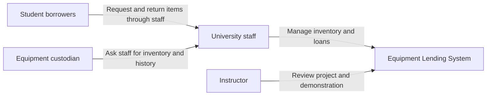
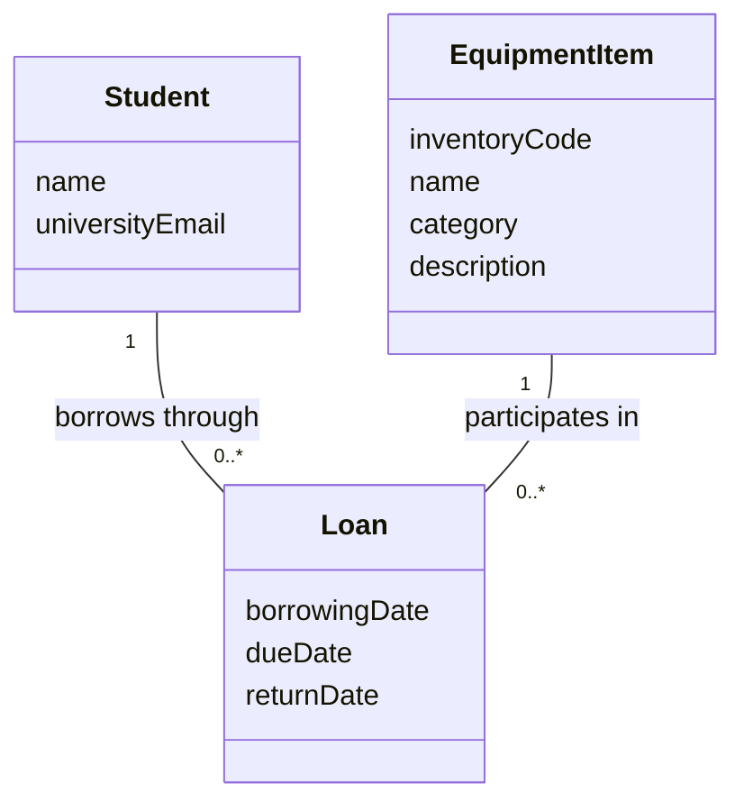
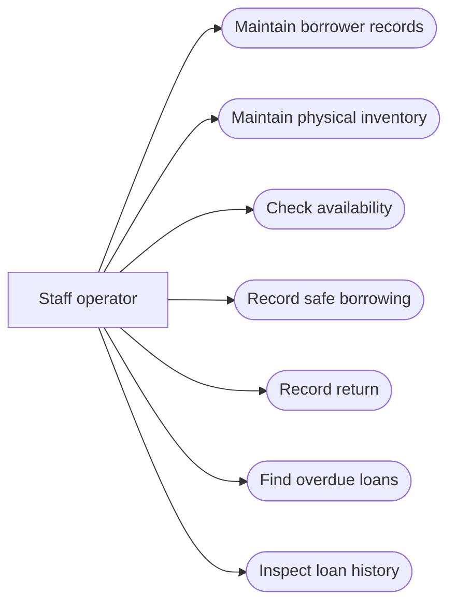
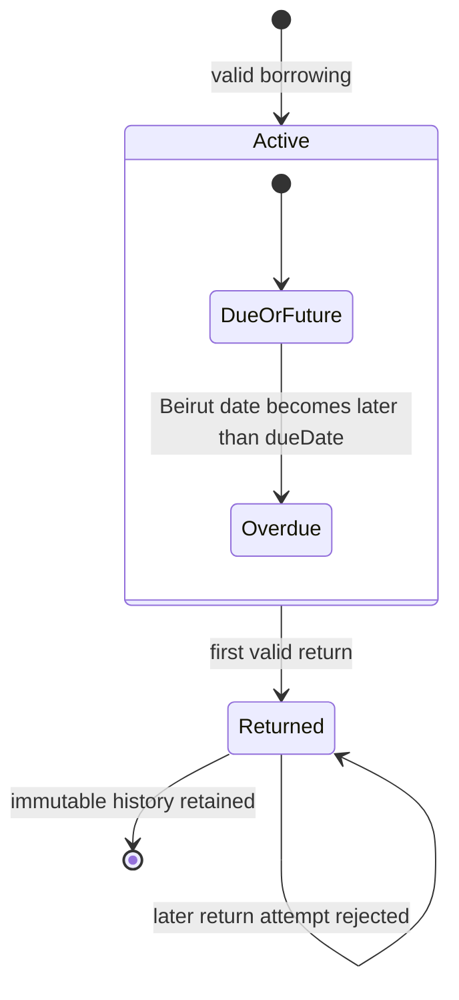

# Equipment Lending Domain and Use Cases

Prepared for ELS-22 and reconciled with the implemented lifecycle under ELS-37. This
analysis describes university lending concepts and actor goals independently of Java classes
or database implementation.

## System context

Students and custodians do not have application accounts in the MVP. Staff are responsible for entering borrower records and dates. The instructor is a project stakeholder, not an application authorization role.

## Conceptual domain model

Every loan involves one borrower and one physical item. An item may have many historical loans but at most one active loan. Availability and overdue are derived facts, not independent editable states. History survives a return.

## Actor goals

## Textual use cases

| Use case | Preconditions | Normal flow and postcondition | Alternatives |
| --- | --- | --- | --- |
| UC01 Maintain student | Authorized staff in delivery configuration | Submit valid name/email; create or update borrower; normalized email stored once | Invalid input 400, missing update/retrieval target 404, duplicate email 409 |
| UC02 Maintain equipment | Staff; item identified by unique physical code | Create/list/update item; delete only if unreferenced | Invalid input 400, missing target 404, duplicate code/history reference 409 |
| UC03 Borrow equipment | Existing student and item; due date after borrowing date | Check availability within transaction, record loan, item becomes unavailable | Missing reference 404, invalid dates 400, active-loan/competing request 409 |
| UC04 Return equipment | Loan exists and is active | Record return on/after borrowing; retain history; item available again | Unknown loan 404, duplicate return 409, earlier return date 400 |
| UC05 Monitor lending | Staff; zero or more loans | List availability, overdue and filtered history with stable ordering | No matches returns []; invalid filters 400 |

UC03 is expanded in [the borrowing specification](../specifications/borrow-equipment.md).

## Loan state model

Overdue is a computed view of an active loan, not a stored transition or mutable status. A loan
is overdue only while unreturned and `dueDate < today`; due today is not overdue. Overdue does
not block a valid return. The self-transition represents a rejected second-return request:
stored history does not change. A later borrowing of the same equipment creates a separate Loan
and therefore a separate state-machine instance; it does not reactivate the returned Loan.
