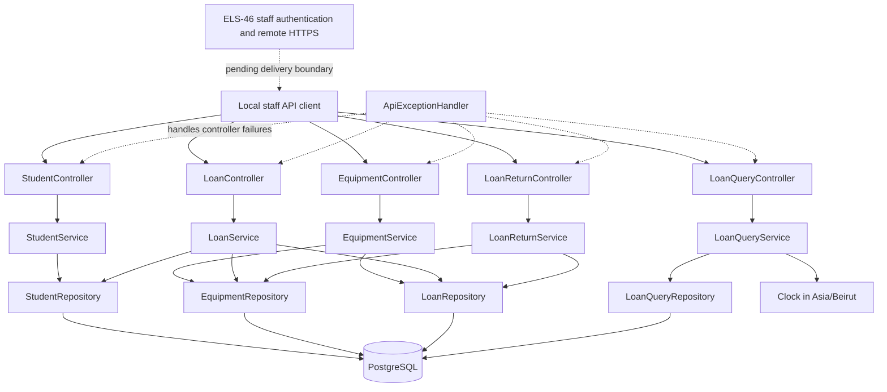
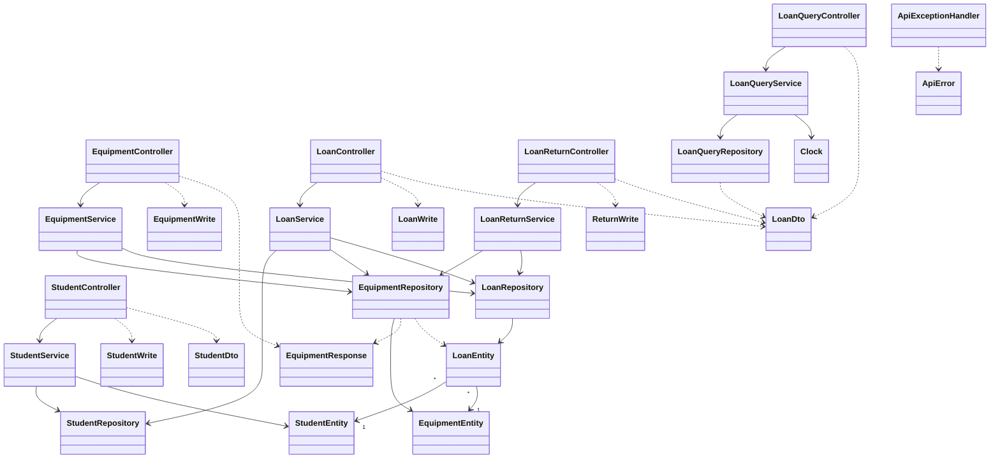
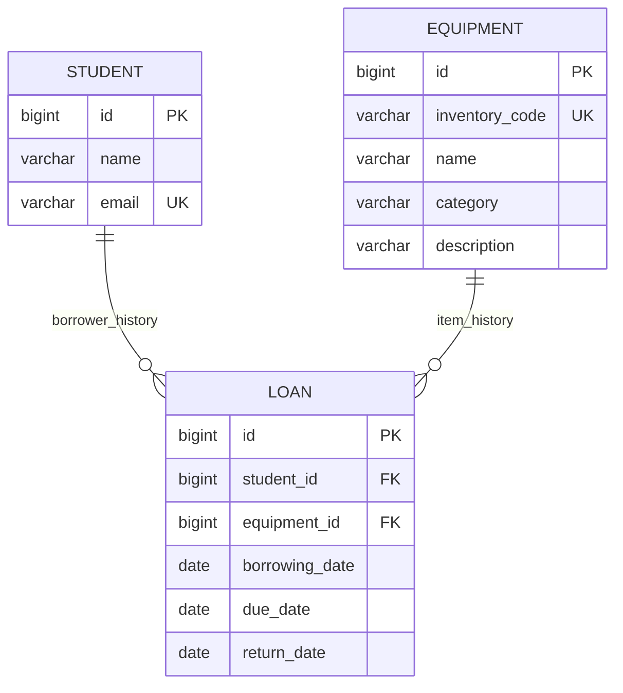
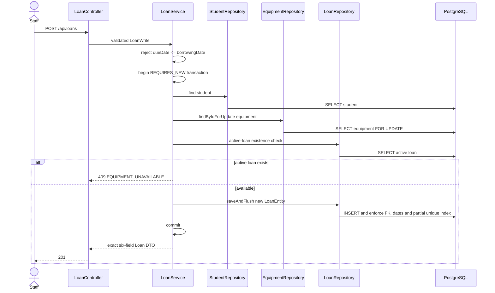
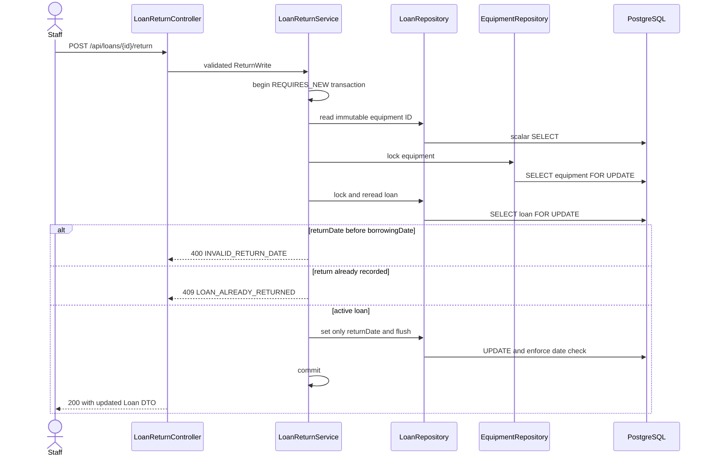
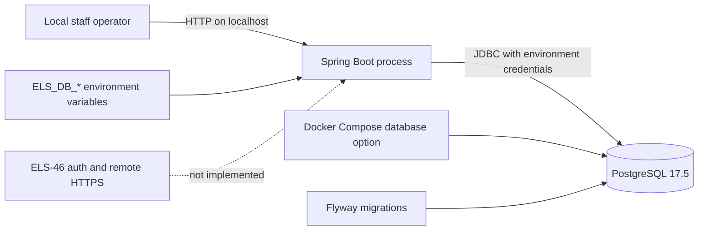

# Equipment Lending Architecture and Data Design

This document reflects the implementation merged through ELS-35. Responsible member: Komayl
Dbouk; assigned ELS-37 reviewer: Hussein Chalhoub (`husseinchalhoubb`).

## Components and responsibilities

The system is one Spring Boot application rooted at `edu.university.equipmentlending`.
`student`, `equipment` and `loan` own their controllers, DTOs, services and feature-specific
repositories. Controllers bind HTTP and DTO validation. Services own transaction boundaries,
normalization and business rules. Repositories access JPA entities or read-only DTO
projections. `shared/config` supplies the strict text parser and application clock;
`shared/error` supplies the public error contract.

The pending ELS-46 node is a requirement, not an active filter. The current application has no
Spring Security configuration and does not emit an authentication challenge. Remote deployment
must not be represented as staff-protected until ELS-46 is implemented and verified.

## Implementation class model

`StudentDto` and `LoanDto` label the Java records
`student.dto.Student` and `loan.dto.Loan`; they are not persistence entities. DTO mapping is
explicit, and controllers never serialize JPA graphs. Repositories do not invoke services or
controllers. Services may share repositories to preserve one lock order without introducing
circular service dependencies.

Student raw limits are validated before trimming. The service trims names, trims and lowercases
email with `Locale.ROOT`, validates normalized email syntax, then writes through a
`REQUIRES_NEW` `TransactionTemplate`. Equipment services trim text, uppercase inventory
codes and use Spring transactions. Loan writes use dedicated transaction templates so commit or
rollback completes before a success or classified conflict leaves the service.

## Relational model

| Column or constraint | Implemented design |
| --- | --- |
| Primary IDs | Database-generated `BIGINT` primary keys |
| Student identifier | Stored normalized email is unique; name/email are required |
| Equipment identifier | Stored normalized inventory code is unique |
| Loan references | Required restrictive foreign keys; history cannot be cascade-deleted |
| Loan dates | Borrowing/due required; return nullable; database checks enforce due after borrowing and return on/after borrowing |
| Active-loan invariant | Partial unique index on `loan(equipment_id)` where `return_date IS NULL` |
| History lookup | Indexes on `loan.student_id` and `loan.equipment_id` |
| Availability and overdue | Derived by queries; no mutable status or availability column |

Flyway V1 owns this schema and Hibernate runs with `ddl-auto=validate`. PostgreSQL, rather than
H2, is required to establish the foreign-key, check, partial-index and locking behavior.

## Borrowing transaction

The student lookup occurs before the equipment lock, but equipment is the first locked mutable
resource. Borrow, return and equipment deletion all serialize on that equipment row. A confirmed
`ux_loan_active_equipment` violation is translated after rollback; unrelated persistence
failures remain sanitized `500 INTERNAL_ERROR`. No successful DTO is returned before commit.

## Return transaction

The scalar reference lookup does not place an unlocked loan entity in the persistence context.
After waiting for equipment, the service locks and rereads the loan, so two valid returns yield
one committed success and one conflict. The original student, equipment and borrowing/due dates
remain immutable; reborrowing creates another row.

Read-only query transactions project loan DTOs directly. History filters combine with AND and
order by loan ID. Equipment lists project response DTOs in one repository query, left joining
only active loans and applying the optional availability filter in the database. The active-loan
partial unique index prevents duplicate equipment results; returned history does not join.
Create/update response mapping still checks availability for the single affected item.
Overdue uses `returnDate IS NULL AND dueDate < today`, where today comes from the injected
Beirut clock.

Equipment conflict classification uses the exact structured Hibernate constraint name and
SQLSTATE, following the student/borrowing convention. A constraint name appearing only in an
exception message or rejected value cannot turn an unrelated persistence failure into a
business conflict. Unrelated failures retain the sanitized internal-error response.

## Deployment model

The reproducible baseline runs the Java process locally and may run PostgreSQL through Docker
Compose. No application container image exists. Secrets belong in an ignored local `.env` and
process environment. Remote access remains prohibited until transport security and staff access
are implemented and verified.

## Decision records

[ADR 001](../decisions/001-layered-application.md) covers architecture,
[ADR 002](../decisions/002-database-and-concurrency.md) covers persistence and locking, and
[ADR 003](../decisions/003-dates-privacy-and-contract.md) covers dates, privacy and API
conventions. See the [human-readable API contract](../api/contract.md) and
[OpenAPI document](../api/openapi.json) for the exact external shapes.
