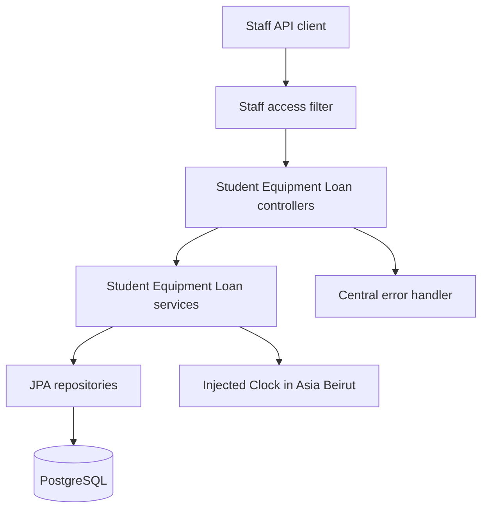
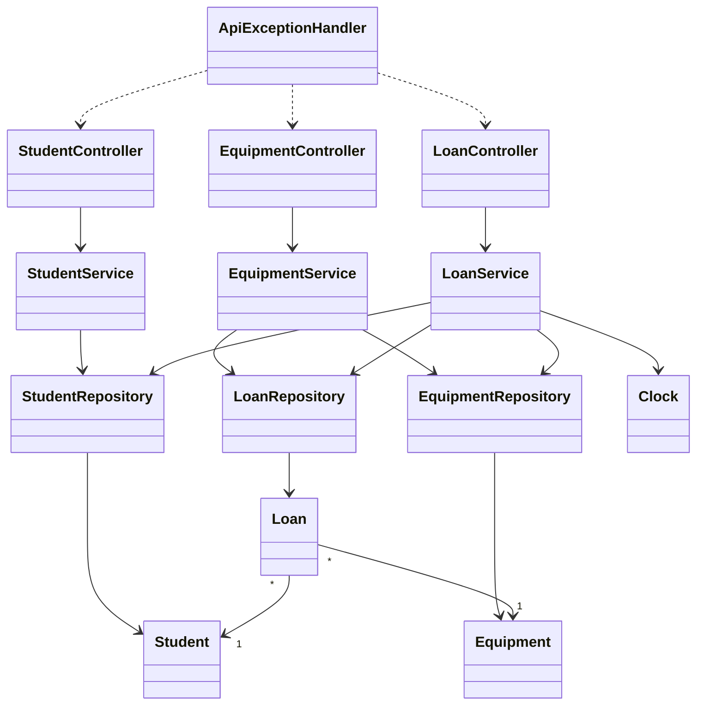
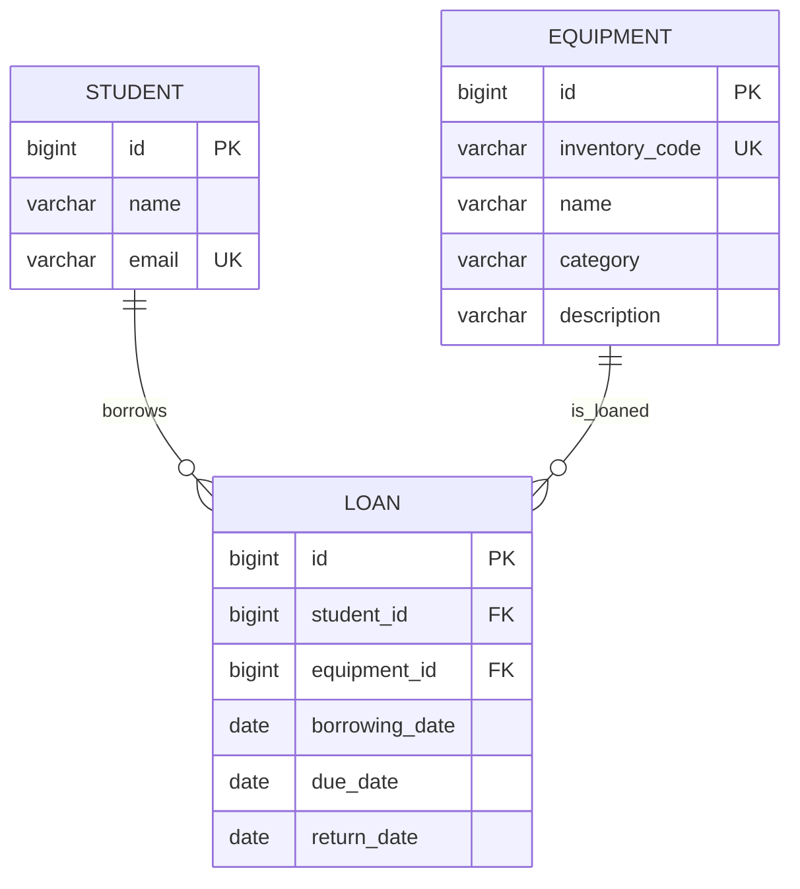
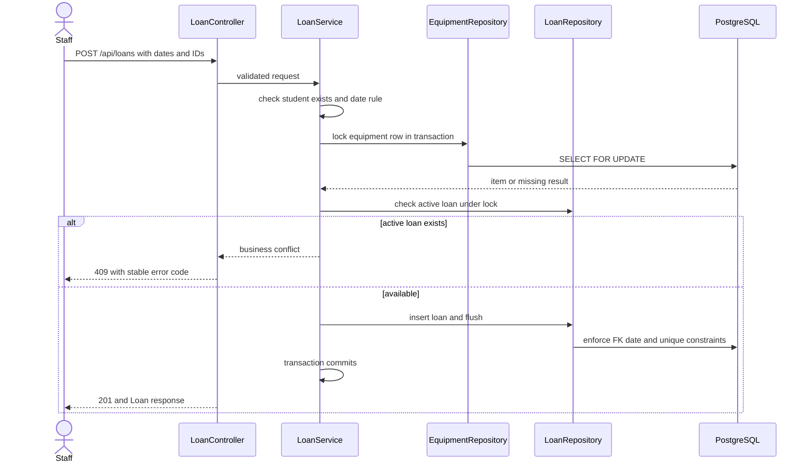
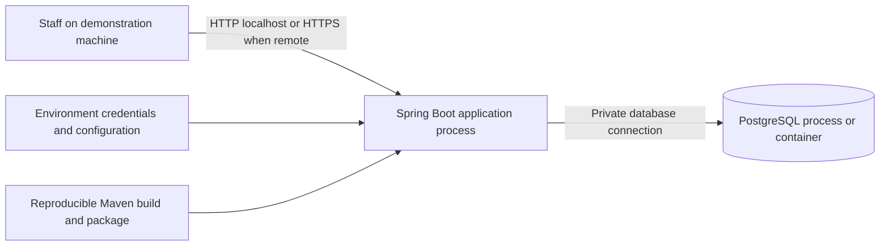

# Equipment Lending Architecture and Data Design

Prepared for ELS-22. Responsible member: Komayl Dbouk; assigned reviewer: Hussein Chreif. These are the target implementation models. Synchronize them with actual source during ELS-37.

## Components and responsibilities

Use a single Spring Boot application with feature packages student, equipment and loan, plus shared error/configuration code. Controllers map HTTP and validate DTOs. Services enforce business rules and own transaction boundaries. Repositories persist/query entities. Request DTOs never accept generated IDs or availability; responses do not serialize JPA graphs.

Staff protection is required for delivery under ELS-46. Internal tests may isolate security explicitly, but that configuration must not become a public demo deployment.

## Implementation class model

Repositories should not invoke controllers or services. Services share repositories rather than introducing circular service dependencies. DTO mapping stays explicit and small. No microservice, queue or event infrastructure is needed.

ELS-29 implements the student layers under `edu.university.equipmentlending.student`: StudentController, StudentService, persistence.StudentRepository and the existing persistence.StudentEntity. dto.StudentWrite accepts only name/email; dto.Student returns only id/name/email. The service validates raw limits before normalization and checks normalized email syntax before persistence. Read transactions are read-only; writes use a service-owned TransactionTemplate with REQUIRES_NEW so the transaction finishes before a confirmed student_email_key uniqueness violation is translated to DUPLICATE_EMAIL. PostgreSQL uniqueness protects canonical email values stored by the API. V1 and other feature mappings are unchanged. See [student verification evidence](../testing/els-29-student-management.md) for tests and pending PostgreSQL execution.

## Relational model

| Column or constraint | Design |
| --- | --- |
| Primary IDs | Generated positive BIGINT; stable references |
| Student name/email | NOT NULL, maximum 120/254; normalized email unique |
| Equipment code/name/category | NOT NULL, maximum 50/120/60; normalized inventory code unique |
| Equipment description | Nullable, maximum 1000 |
| Loan references | NOT NULL foreign keys; restrictive delete behavior, no cascading deletion of history |
| Loan dates | Borrowing/due required; return nullable; due > borrowing and return >= borrowing when non-null |
| Active-loan invariant | PostgreSQL unique partial index on equipment_id for rows with return_date IS NULL |
| Query support | Index loan.student_id and loan.equipment_id for history; consider active due-date index after measurement |

Versioned schema migrations establish constraints. JPA schema auto-update must not be the delivery schema-management strategy. H2 may support isolated fast tests but cannot establish PostgreSQL behavior.

## Atomic borrowing sequence

Transaction isolation is READ COMMITTED with explicit equipment row locking. Two contenders serialize on that item; the second checks state after the first commits. The partial unique index protects the invariant from alternate write paths. Map a confirmed active-loan unique violation to 409 outside the failed transaction; do not reuse an aborted transaction or convert unrelated database failures into borrowing conflicts. Unexpected failures remain sanitized 500 responses. No success response is sent before commit.

Borrow, return and equipment deletion all obtain the equipment lock first. Return may read the loan's immutable equipment ID to locate the lock, then lock/re-read the loan and recheck active state. Delete checks all historical references while locked and also relies on FK restriction. Keep transactions short and never perform network calls inside locks. Availability is a point-in-time query, not a reservation guarantee.

## Deployment model

The reliable baseline is a local demonstration. Docker packaging is planned, with a documented Maven plus local PostgreSQL alternative if containers are unavailable. Remote access needs transport security and staff authentication; do not expose a development profile. ELS-23 selects compatible pinned dependency versions and exact commands.

## Decision records

[ADR 001](../decisions/001-layered-application.md) covers architecture, [ADR 002](../decisions/002-database-and-concurrency.md) persistence/concurrency and [ADR 003](../decisions/003-dates-privacy-and-contract.md) dates/privacy/API conventions. [The contract](../api/contract.md) and [OpenAPI](../api/openapi.json) define interface details.
