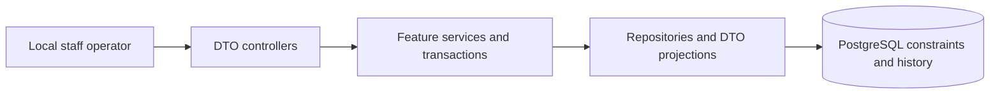

# University Equipment Lending System Software Engineering Report

Team: Hussein Chreif, Mostafa Younes, Komayl Dbouk and Hussein Chalhoub. Report owner: Hussein Chreif. Assigned reviewer: Hussein Chalhoub.

## Summary and evidence boundary

We developed a staff-managed REST API for university equipment lending. The merged application manages students and equipment, prevents simultaneous active loans for one item, records returns once and exposes availability, overdue loans and filtered history. Evidence includes a written borrowing specification, preserved red tests before implementation, real PostgreSQL concurrency/rollback checks, three strengthened test oracles, a restored deliberate-defect experiment and two approved design corrections.

This preparation version describes [merged revision c1a621d](https://github.com/komayl-dbouk/Equipment-Lending-System/commit/c1a621df42ec0a8d555b2cfd17bdc8d7c4d094ee). Final acceptance still requires the refactoring/measured-improvement cycle, Sprint 3 closeout and release/security/acceptance/rehearsal evidence. The [finalization checklist](finalization-checklist.md) and [structured evidence status](final-report-evidence.json) distinguish these pending results from verified work. Preparing this report does not complete ELS-48 or the submission package.

## Problem stakeholders and scope

Fragmented equipment and borrower records make availability, accountability and overdue follow-up difficult. University staff operate the API; students are borrowers and data subjects; custodians need history; the instructor needs inspectable engineering evidence. We used the proposed workflow and staff-role scenario analysis to identify needs. This is an explicit stakeholder assumption, not a claimed university interview.

The [proposal](../docs/proposal.md) records value, feasibility, risks and release scope. [Requirements](../docs/requirements/requirements.md) define identifiers, priorities, acceptance and quality constraints. The MVP includes student registration/retrieval/update; equipment creation/list/update/history-safe deletion; borrowing; returns; and availability, overdue and history queries. Its eleven data operations exclude query-parameter variants from the operation count. Student accounts, a browser UI, reservations, fines, notifications and institutional integrations are outside scope. OpenAPI and executable API examples provide the backend interface model.

The current local runtime is unauthenticated. Staff access, unauthenticated error behavior and remote HTTPS remain ELS-46 delivery requirements. Local lending verification does not establish those controls.

## Requirements and acceptance

| Requirement | Observable behavior | Implementation and evidence |
| --- | --- | --- |
| FR01 | Maintain normalized student records and reject invalid/duplicate input | [StudentService](../src/main/java/edu/university/equipmentlending/student/StudentService.java), [verification](../docs/testing/els-29-student-management.md) |
| FR02 | Maintain equipment and delete only unreferenced items | [EquipmentService](../src/main/java/edu/university/equipmentlending/equipment/EquipmentService.java), [integrated workflow](sprint-2/els-36-lending-validation.md) |
| FR03 and FR04 | Create a valid loan atomically; one active loan per item under contention | [Specification](../docs/specifications/borrow-equipment.md), [BorrowingContractIT](../src/test/java/edu/university/equipmentlending/loan/BorrowingContractIT.java) |
| FR05 | Return once, restore availability and retain reborrow history | [Return evidence](../docs/testing/els-34-loan-returns.md), [return tests](../src/test/java/edu/university/equipmentlending/loan/LoanReturnContractIT.java) |
| FR06 | Ordered availability/history filters and Beirut-date overdue selection | [Contract](../docs/api/contract.md), [query tests](../src/test/java/edu/university/equipmentlending/loan/LendingQueriesIT.java) |
| FR07 | Preserve history and prevent delete/borrow orphaning | [Integrity tests](../src/test/java/edu/university/equipmentlending/loan/LendingIntegrityIT.java), [workflow evidence](sprint-2/els-36-lending-validation.md) |

[Requirements traceability](../docs/requirements/traceability.md) also identifies nonfunctional implementation and gaps. Integrity and reproducibility have executed evidence; delivery access/privacy and the full measured-quality improvement remain partial. The [testing strategy](../docs/testing/test-strategy.md) distinguishes automated verification from final acceptance scenarios.

## Architecture and decisions

Java 17, Spring Boot 3.5.16, Maven Wrapper 3.9.11 and PostgreSQL 17.5 form the pinned baseline. One deployment contains student, equipment and loan feature packages. Controllers bind DTOs/validation; services own normalization, rules and transactions; repositories own persistence and query projections. Shared code contains configuration and the error contract.

[Domain/use-case models](../docs/analysis/domain-and-use-cases.md) separate business concepts from Java classes. The [architecture/class/data/sequence/deployment models](../docs/design/architecture.md) describe the implemented baseline; final synchronization must be rechecked after ELS-42.

A layered single application keeps deployment and cross-feature transactions manageable for four developers. PostgreSQL provides restrictive references, date checks and an active-loan partial unique index. Flyway owns schema delivery; Hibernate validates rather than creates/updates it. [ADR 001](../docs/decisions/001-layered-application.md), [ADR 002](../docs/decisions/002-database-and-concurrency.md) and [ADR 003](../docs/decisions/003-dates-privacy-and-contract.md) record alternatives and trade-offs.

Borrowing, returns and equipment deletion share equipment-first locking. Return locks equipment before rereading the loan and changes only its return date. Loan transaction boundaries complete commit before reporting success; database constraints also protect independent SQL writers. Availability and overdue state are derived rather than editable flags.

## Teamwork and delivery

| Member | Evidenced responsibilities and contributions |
| --- | --- |
| Hussein Chreif | Borrowing specification/red tests, shared validation/CI work, reviews, design corrections, sprint audit and report preparation |
| Mostafa Younes | Students, returns, integrated validation and generated-test audit |
| Komayl Dbouk | Domain/equipment, atomic borrowing, API documentation, peer review and ongoing refactoring |
| Hussein Chalhoub | Foundation/queries, CI support, peer review, deliberate-defect experiment and planned measurement/delivery work |

Jira holds goals, assignments, estimates, acceptance and progress. [Sprint 1](sprint-1/progress-review-and-retrospective.md) and [Sprint 2](sprint-2/progress-review-and-retrospective.md) closeouts distinguish verified increments from missing meeting/session records. Sprint 3 is active and Sprint 4 planned. Final rehearsal and individual understanding remain ELS-49.

Our [working agreement](../docs/team-plan.md) uses one issue branch without a codex prefix, issue-key commits, reviewed significant plans, named peer review and human merge. ELS-38's separate closeout review was explicitly waived by the project lead; that exception does not waive other card reviews. All members contribute beyond a single module, and final explanation/review remains a team responsibility.

## Specification and test first borrowing

The [borrowing specification](../docs/specifications/borrow-equipment.md), [agent plan](../docs/specifications/borrow-agent-plan.md) and [plan review](../docs/reviews/borrowing-plan-review.md) precede lending implementation. Normal/error flows, strict inputs, transactional integrity and prohibited scope define observable acceptance.

[Test commit a847e09](https://github.com/komayl-dbouk/Equipment-Lending-System/commit/a847e093f82fa64bf4f85193a786247adf5de492) contains 53 borrowing contract cases before the endpoint existed. [Red evidence](sprint-2/els-32-test-first-evidence.md) records 53 behavioral failures, zero errors/skips and 203 existing passing checks. Production stubs and disabled assertions were not used to hide the missing behavior.

Implementation and [correction 3f9e49d](https://github.com/komayl-dbouk/Equipment-Lending-System/commit/3f9e49d2f2b379460b3414ef8fe43ba16faac4a8) produced green borrowing evidence. A generated accessor conflicted with Spring Data query resolution and was removed before the passing run. Later review found expanded years reaching persistence; [a0cc76c](https://github.com/komayl-dbouk/Equipment-Lending-System/commit/a0cc76c8fe700975490902b583d3bef2765437dc) enforced the agreed date shape and added nine regressions. The [implementation log](../ai-log/els-33-atomic-borrowing.md) retains these corrections. Original red tests remain unchanged in ancestry; ELS-42 must establish its own refactoring evidence.

## Testing and quality evidence

| Stage | Revision and observed result | Interpretation |
| --- | --- | --- |
| Integrated lending | [ELS-36](sprint-2/els-36-lending-validation.md), 32cda80: 362 tests; 83 packaged HTTP requests/626 assertions passed | Independent SQL values/state and coordinated races; final release acceptance remains separate |
| Pre-change quality baseline | [Baseline](sprint-2/quality-baseline.md), b5e6a32: service lines 160/168 (95.24%), branches 61/68 (89.71%); nine SpotBugs warnings, zero analysis errors | Five-service scope; warnings need triage; after-improvement result pending |
| Design corrections | [ELS-41](sprint-3/els-41-design-corrections.md), dbb2b55: 381 tests and 83 HTTP requests/626 assertions passed | Added classification/projection regressions; original schema and borrowing tests preserved |
| Test-audit author run | [ELS-39](sprint-3/els-39-verification.md), cc1997b: 364 tests passed | Original baseline excludes later merged ELS-41 tests |
| Integrated independent review | [Review record](https://equipment-lending-system.atlassian.net/browse/ELS-39?focusedCommentId=10109), f61113f: 195 unit/controller plus 188 PostgreSQL integration, 383 total, zero failures/errors/skips | All three audit probes independently reproduced and restored |
| Latest merged baseline | [CI on c1a621d](https://github.com/komayl-dbouk/Equipment-Lending-System/actions/runs/45964282514/job/140389125999) passed | Contains reviewed source/tests; report preparation does not claim a new local runtime run |

Counts belong to specific revisions/scopes and are not added across runs. PostgreSQL suites cover references, dates, normalized uniqueness, active-loan uniqueness, immediate/deferred rollback, history and concurrent operations. Error tests verify codes and sanitized bodies. Separate guarded databases, credentials and synthetic fixtures protect test isolation.

[ELS-39's matrix](sprint-3/els-39-test-audit.md) reviews 14 existing methods: 11 meaningful and three weak. Corrections require exact active/returned student history, put the fixed Clock across the UTC/Beirut date boundary, and vary student/equipment references independently in direct index tests. [Probe evidence](sprint-3/els-39-probe-results.json) shows the old query class passed 15 tests under each of the first two faults while corrected assertions detected each with one failure. Old integrity tests passed four cases under a wrongly student-keyed index; supplementary cases detected it with two failures. Source/index restoration precedes normal green verification. This is scoped discrimination evidence rather than a statistical mutation score.

[ELS-40](sprint-3/els-40-deliberate-defect-experiment.md) separately weakened the borrowing comparison to permit equal dates. One of eight service tests and one of 53 PostgreSQL contract cases failed. The database prevented an invalid row, but its 500 response violated the required 400 business contract. Exact restoration and full green checks completed the experiment.

The [ELS-41 review](../docs/reviews/els-41-design-review-and-plan.md) obtained approval for two important findings before production edits. Exact constraint/SQLSTATE metadata corrected a controlled unrelated-constraint misclassification. A repository projection reduced a 24-item list from 25 statements to one while preserving contract values/order/filtering. Genuine inventory contention still produced one creation, one conflict and one row. [Execution evidence](sprint-3/els-41-design-corrections.md) records statement counts rather than an invented latency SLA.

## Refactoring and measured improvement pending

Komayl is working on [ELS-42](https://equipment-lending-system.atlassian.net/browse/ELS-42). Final reporting requires three genuine smells, before/after changes, green baselines/regressions and maintenance implications after review/merge. No completed refactoring count is assigned here.

[ELS-43](https://equipment-lending-system.atlassian.net/browse/ELS-43) must confirm a significant measured concern, retain the original result, correct it and repeat comparable tools/tests. The [GQM plan](../docs/testing/gqm-plan.md) connects goals, questions, results, interpretation and action. Preserve JaCoCo 0.8.11 and SpotBugs plugin 4.8.3.1/engine 4.8.3 scope/settings or explain comparison changes. A fresh coverage file must accumulate both test JVMs. The nine baseline warnings are not nine confirmed defects or an after-change result; high coverage did not prevent the weak oracles above.

## Effort and AI reflection

Sprint 1 retains a 24-hour estimate with actuals not supplied. Sprint 2 retains a 20-hour estimate and project-lead-confirmed approximate actual effort of 20 hours:

| Member | Original estimate | Confirmed approximate actual | Difference |
| --- | --- | --- | --- |
| Hussein Chreif | 4h | 6h | +2h |
| Komayl Dbouk | 7h | 5h | -2h |
| Mostafa Younes | 6h | 5h | -1h |
| Hussein Chalhoub | 3h | 4h | +1h |
| Total | 20h | 20h | 0h |

These are retrospective approximations confirmed by the project lead, not precise sessions or separate member confirmations. Per-card allocations, interruptions and explanations of individual differences were not supplied. The [Sprint 2 record](sprint-2/progress-review-and-retrospective.md) preserves that limit. A matching total does not establish productivity, measured AI savings or improved estimates across sprints. Sprint 3/4 actuals remain to be supplied.

Codex assisted specifications, Java/tests, diagrams, review, debugging and documentation. Verification required judgment: generated accessors affected query resolution, expanded dates violated the contract, plausible tests missed faults and independently valid GQM updates conflicted at integration. The process improvement is to retain a pre-change baseline and inspect acceptance, rejection boundaries, committed state, current CI and peer decisions before integration. Agent runtime does not substitute for human effort.

## Responsible AI and maintenance

Selected AI records linked below identify context, plans, interpretations, corrections, tests and decisions. Exact model metadata is not consistently recorded and is not reconstructed. Accepted outputs include reviewed plans; modified outputs include date/parser and query/error corrections; warning-based changes were screened rather than accepted automatically.

Examples use synthetic data. Credentials stay in local environment/configuration or credential helpers and are absent from this report. The assignment remains a local untracked input. Final secret-history/log, license/IP and staff-access verification remains [ELS-46](https://equipment-lending-system.atlassian.net/browse/ELS-46). Four-member report review and understanding are still required; no meeting or rehearsal is inferred.

The [maintenance plan](../docs/maintenance/maintenance-plan.md) covers corrective, adaptive, perfective and preventive changes, dependency/schema/context/test updates, debt, validation and rollback responsibilities. New features require a reviewed scope decision.

## Reference practice traceability

This maintained table belongs directly in the consolidated report. Pending rows identify remaining evidence, not completion. The Library API reference supplies practices rather than equipment-project code, screenshots or results.

| Reference practice | Equipment project adaptation | Direct evidence | Sprint | Result or reflection |
| --- | --- | --- | --- | --- |
| AI assisted engineering workflow | Reviewed plans, scoped generation, testing and correction | [Borrowing log](../ai-log/els-33-atomic-borrowing.md), [design log](../ai-log/els-41-design-review.md) | Throughout | Decisions/corrections inspectable; final understanding remains human |
| Agile planning | Assigned estimated backlog and reviewed increments | [Board](https://equipment-lending-system.atlassian.net/jira/software/c/projects/ELS/boards/34), [team plan](../docs/team-plan.md), [Sprint 2](sprint-2/progress-review-and-retrospective.md) | All | Sprints 1/2 closed; quality/delivery work remains |
| Agent context | Project-specific architecture, commands and protected inputs | [AGENTS.md](../AGENTS.md), [foundation log](../ai-log/els-23-foundation.md) | 1 onward | Final context update follows architecture/tool changes |
| Specification driven development | Written borrowing rules and plan before code | [Specification](../docs/specifications/borrow-equipment.md), [plan](../docs/specifications/borrow-agent-plan.md), [review](../docs/reviews/borrowing-plan-review.md) | 1 and 2 | Normal/error/concurrency criteria guided implementation |
| Test first development | Failing tests precede green lending code | [Red evidence](sprint-2/els-32-test-first-evidence.md), [test commit](https://github.com/komayl-dbouk/Equipment-Lending-System/commit/a847e093f82fa64bf4f85193a786247adf5de492), [implementation](../ai-log/els-33-atomic-borrowing.md) | 2 | Original tests and chronology preserved |
| Design review | Reproduce, classify and approve important corrections | [Review](../docs/reviews/els-41-design-review-and-plan.md), [results](sprint-3/els-41-design-corrections.md) | 3 | Two important concerns corrected; warnings need context |
| Refactoring | Three smells and behavior-preserving changes | [ELS-42](https://equipment-lending-system.atlassian.net/browse/ELS-42) | 3 | In progress; final before/after/test evidence pending |
| Measures and metrics | Goal-led baseline and comparable measured correction | [GQM](../docs/testing/gqm-plan.md), [baseline](sprint-2/quality-baseline.md), [ELS-43](https://equipment-lending-system.atlassian.net/browse/ELS-43) | 1 and 3 | Baseline captured; after comparison/action pending |
| Testing | Unit/controller/PostgreSQL, HTTP, boundary and rollback checks | [Strategy](../docs/testing/test-strategy.md), [workflow](sprint-2/els-36-lending-validation.md), [ELS-47](https://equipment-lending-system.atlassian.net/browse/ELS-47) | Throughout | Core workflow verified; final acceptance pending |
| AI test audit | Classify methods and prove stronger oracles | [Matrix](sprint-3/els-39-test-audit.md), [probes](sprint-3/els-39-probe-results.json), [PR 17](https://github.com/komayl-dbouk/Equipment-Lending-System/pull/17) | 3 | 14 methods; three distinct weaknesses corrected |
| Estimation | Preserve estimates and supplied approximate actuals | [Sprint 2 effort](sprint-2/progress-review-and-retrospective.md), [templates](../docs/testing/evidence-templates.md) | All | Aggregate 20h/20h; precise sessions/other actuals incomplete |
| Deployment | Pinned execution and clean-clone/package verification | [Runbook](../docs/deployment/local-setup.md), [CI](../docs/testing/ci.md), [ELS-45](https://equipment-lending-system.atlassian.net/browse/ELS-45) | 4 | Packaged checks exist; final clean-setup evidence pending |
| Responsible AI | Disclosure, human decisions, privacy and IP review | [AI record format](../ai-log/interaction-template.md), [ELS-46](https://equipment-lending-system.atlassian.net/browse/ELS-46) | Throughout | Synthetic fixtures/review evidenced; final governance pending |

## Delivery and finalization

The current path is the executable JAR, documented environment variables, separate PostgreSQL services and API examples. [Local setup](../docs/deployment/local-setup.md), [OpenAPI](../docs/api/openapi.json) and [executable examples](../docs/api/examples.ps1) support reproducibility. The proposal permits a reliable local demonstration. No application container image, public endpoint, final clean-clone release, authentication challenge or final rehearsal is claimed here.

Complete ELS-42/43/44, attach release/setup/security/acceptance results from ELS-45/46/47, update to the final reviewed revision and review the report with all four members under ELS-48. ELS-49/50 supply rehearsal/submission evidence. Every member must explain a requirement, architecture decision, test oracle, corrected AI output, quality improvement and personal contribution. The [finalization checklist](finalization-checklist.md) tracks the remaining records.
