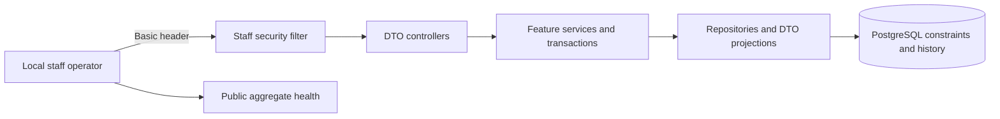

# University Equipment Lending System Software Engineering Report

Team: Hussein Chreif, Mostafa Younes, Komayl Dbouk and Hussein Chalhoub. Report owner: Hussein Chreif. Assigned reviewer: Hussein Chalhoub.

## Summary and evidence boundary

We developed a staff-managed REST API for university equipment lending. The merged application manages students and equipment, prevents simultaneous active loans for one item, records returns once and exposes availability, overdue loans and filtered history. Evidence includes a written borrowing specification, preserved red tests before implementation, real PostgreSQL concurrency/rollback checks, three strengthened test oracles, a restored deliberate-defect experiment and two approved design corrections.

This report consolidates the reviewed backend delivery at [merged revision 62be246](https://github.com/komayl-dbouk/Equipment-Lending-System/commit/62be2464b7281d2657e3de207891fc7e5a95507d). Quality work, reproducible Docker packaging, staff access and all 28 technical acceptance scenarios are complete, with [passing merged-revision CI](https://github.com/komayl-dbouk/Equipment-Lending-System/actions/runs/46082812139/job/140785480679). The [evidence ledger](final-report-evidence.json) preserves exact source/run identities, historical results and actual human approvals. This documentation update does not claim a new local runtime or metric run.

The [four-member report review](els-48-team-review.md), including primary peer reviewer Hussein Chalhoub, is accepted after correction of stale human-acceptance status, as explicitly confirmed by project lead Hussein Chreif. He also confirmed all four participated in the presentation rehearsal and covered individual explanations, Q&A, debugging and handovers; see the [ELS-49 record](sprint-4/els-49-team-rehearsal.json). These are relayed human confirmations, separate from automated technical acceptance. ELS-50 now records [confirmed Sprint 4 effort/reflection](sprint-4/progress-review-and-retrospective.md) and an inspectable [source candidate/notices handoff](release/submission-checklist.md). Official submission details, instructor access, final reviewed-revision regeneration and the actual receipt remain separate in the [finalization checklist](finalization-checklist.md).

## Problem stakeholders and scope

Fragmented equipment and borrower records make availability, accountability and overdue follow-up difficult. University staff operate the API; students are borrowers and data subjects; custodians need history; the instructor needs inspectable engineering evidence. We used the proposed workflow and staff-role scenario analysis to identify needs. This is an explicit stakeholder assumption, not a claimed university interview.

The [proposal](../docs/proposal.md) records value, feasibility, risks and release scope. [Requirements](../docs/requirements/requirements.md) define identifiers, priorities, acceptance and quality constraints. The MVP includes student registration/retrieval/update; equipment creation/list/update/history-safe deletion; borrowing; returns; and availability, overdue and history queries. Its eleven data operations exclude query-parameter variants from the operation count. Student accounts, a browser UI, reservations, fines, notifications and institutional integrations are outside scope. OpenAPI and executable API examples provide the backend interface model.

Every business operation now requires a privately configured staff Basic credential. Missing/blank settings fail startup; missing/wrong authentication returns the same sanitized 401 without writes. Only aggregate health is public. The Docker application is published on loopback and PostgreSQL is internal-only. Remote use still requires separately verified HTTPS; Basic encoding does not encrypt credentials. Browser authentication/CSRF/origin behavior is not established by these CLI/API checks. A frontend is planned as a separate Sprint 5 backlog increment and is not part of this verified backend release.

## Requirements and acceptance

| Requirement | Observable behavior | Implementation and final evidence |
| --- | --- | --- |
| FR01 | Normalized student creation/retrieval/replacement; invalid/duplicate rejection | [StudentService](../src/main/java/edu/university/equipmentlending/student/StudentService.java); [TC01-TC03, TC24](sprint-4/els-47-final-release-acceptance.md) |
| FR02 | Inventory creation/list/replacement and unreferenced deletion | [EquipmentService](../src/main/java/edu/university/equipmentlending/equipment/EquipmentService.java); [TC04-TC06, TC24](sprint-4/els-47-final-release-acceptance.md) |
| FR03 | Valid dates/references create one committed loan; invalid/unavailable requests preserve state | [Specification](../docs/specifications/borrow-equipment.md), [LoanService](../src/main/java/edu/university/equipmentlending/loan/LoanService.java); [TC07-TC10](sprint-4/els-47-final-release-acceptance.md) |
| FR04 | Coordinated contenders create one active loan, one success and one conflict | [Borrowing tests](../src/test/java/edu/university/equipmentlending/loan/BorrowingContractIT.java); [TC11](sprint-4/els-47-final-release-acceptance.md) |
| FR05 | Return once, preserve history, restore availability and allow reborrow | [Return tests](../src/test/java/edu/university/equipmentlending/loan/LoanReturnContractIT.java); [TC12-TC15](sprint-4/els-47-final-release-acceptance.md) |
| FR06 | Complete sorted availability/history/AND-filter and Beirut-date overdue results | [Contract](../docs/api/contract.md), [query tests](../src/test/java/edu/university/equipmentlending/loan/LendingQueriesIT.java); [TC16-TC18, TC25](sprint-4/els-47-final-release-acceptance.md) |
| FR07 | Active/returned history blocks deletion; delete/borrow never leaves an orphan | [Integrity tests](../src/test/java/edu/university/equipmentlending/loan/LendingIntegrityIT.java); [TC19-TC20](sprint-4/els-47-final-release-acceptance.md) |
| NFR01 | PostgreSQL constraints, transaction rollback and concurrent integrity | [TC03/05/07-15/19-20/24-25](sprint-4/els-47-final-release-acceptance.md), full SQL snapshots and real forced failures |
| NFR02 | Clean tracked build, documented runtime image, seeded workflow and owned cleanup | [Runbook](../docs/deployment/local-setup.md), [packaging](sprint-4/els-45-reproducible-packaging.md), [TC23](sprint-4/els-47-final-release-acceptance.md) |
| NFR03 | Staff-only data access, sanitized errors/logs and private configuration | [Staff boundary](../docs/deployment/staff-access.md), [access/privacy/license review](sprint-4/els-46-access-privacy-license-review.md), [TC21-TC22](sprint-4/els-47-final-release-acceptance.md) |
| NFR04 | DTO/service/repository ownership, source-aligned models and safe changes | [Architecture](../docs/design/architecture.md), [refactorings](sprint-3/els-42-safe-refactorings.md), [AQ01](sprint-4/els-47-final-release-acceptance.md) |
| NFR05 | Meaningful oracles, audit/defect experiments and revision-scoped quality measurement | [Audit](sprint-3/els-39-test-audit.md), [quality](sprint-3/els-43-measured-quality-improvement.md), [AQ02](sprint-4/els-47-final-release-acceptance.md) |

[Detailed traceability](../docs/requirements/traceability.md) and [structured acceptance](sprint-4/els-47-acceptance-results.json) bind each criterion to preconditions, steps, expected/observed outcomes, exact source/environment and evidence. All 28 technical rows passed. Remote HTTPS, browser acceptance and human report/rehearsal/submission decisions remain explicitly separate.

## Architecture and decisions

Java 17, Spring Boot 3.5.16, Maven Wrapper 3.9.11 and PostgreSQL 17.5 form the pinned baseline. One deployment contains student, equipment and loan feature packages. Controllers bind DTOs/validation; services own normalization, rules and transactions; repositories own persistence and query projections. Shared code contains configuration/security, the public error contract and exact persistence-constraint matching.

[Domain/use-case models](../docs/analysis/domain-and-use-cases.md) separate business concepts from Java classes. The [architecture/class/data/sequence/deployment models](../docs/design/architecture.md) describe the integrated DTO layers, shared persistence classifier, loan mapper and staff-access/container boundary.

Java records represent request/response values; feature services encapsulate rules and transaction ownership; injected repository interfaces isolate persistence. Entities expose controlled state changes, while the shared exception hierarchy maps failures to one public API shape. The conceptual model remains separate from these implementation classes.

A layered single application keeps deployment and cross-feature transactions manageable for four developers. PostgreSQL provides restrictive references, date checks and an active-loan partial unique index. Flyway owns schema delivery; Hibernate validates rather than creates/updates it. [ADR 001](../docs/decisions/001-layered-application.md), [ADR 002](../docs/decisions/002-database-and-concurrency.md) and [ADR 003](../docs/decisions/003-dates-privacy-and-contract.md) record alternatives and trade-offs.

Borrowing, returns and equipment deletion share equipment-first locking. Return locks equipment before rereading the loan and changes only its return date. Loan transaction boundaries complete commit before reporting success; database constraints also protect independent SQL writers. Availability and overdue state are derived rather than editable flags.

## Teamwork and delivery

| Member | Evidenced responsibilities and contributions |
| --- | --- |
| Hussein Chreif | Borrowing specification/red tests, shared validation/CI work, reviews, design corrections, sprint audit and report preparation |
| Mostafa Younes | Students, returns, integrated validation, generated-test audit and final acceptance ownership |
| Komayl Dbouk | Domain/equipment, atomic borrowing, API documentation, three refactorings, staff-access ownership and peer review |
| Hussein Chalhoub | Foundation/queries, peer review, deliberate-defect experiment, quality measurement and reproducible packaging |

Jira holds goals, assignments, estimates, acceptance and progress. [Sprint 1](sprint-1/progress-review-and-retrospective.md) and [Sprint 2](sprint-2/progress-review-and-retrospective.md) closeouts distinguish verified increments from missing meeting/session records. [Sprint 3 closeout](sprint-3/progress-review-and-retrospective.md) was accepted in [PR #21](https://github.com/komayl-dbouk/Equipment-Lending-System/pull/21). Sprint 4 is active; ELS-49 rehearsal and explanation coverage are confirmed by the project lead, with source and limits in the rehearsal record. These are responsibility/evidence summaries, not claims that one person exclusively authored a module: the commit/AI/review records also document shared project-lead corrections.

Our [working agreement](../docs/team-plan.md) uses one issue branch without a codex prefix, issue-key commits, reviewed significant plans, named peer review and human merge. ELS-38's separate closeout review was explicitly waived by the project lead; that exception does not waive other card reviews. All members contribute beyond a single module, and final explanation/review remains a team responsibility.

## Specification and test first borrowing

The [borrowing specification](../docs/specifications/borrow-equipment.md), [agent plan](../docs/specifications/borrow-agent-plan.md) and [plan review](../docs/reviews/borrowing-plan-review.md) precede lending implementation. Normal/error flows, strict inputs, transactional integrity and prohibited scope define observable acceptance.

[Test commit a847e09](https://github.com/komayl-dbouk/Equipment-Lending-System/commit/a847e093f82fa64bf4f85193a786247adf5de492) contains 53 borrowing contract cases before the endpoint existed. [Red evidence](sprint-2/els-32-test-first-evidence.md) records 53 behavioral failures, zero errors/skips and 203 existing passing checks. Production stubs and disabled assertions were not used to hide the missing behavior.

Implementation and [correction 3f9e49d](https://github.com/komayl-dbouk/Equipment-Lending-System/commit/3f9e49d2f2b379460b3414ef8fe43ba16faac4a8) produced green borrowing evidence. A generated accessor conflicted with Spring Data query resolution and was removed before the passing run. Later review found expanded years reaching persistence; [a0cc76c](https://github.com/komayl-dbouk/Equipment-Lending-System/commit/a0cc76c8fe700975490902b583d3bef2765437dc) enforced the agreed date shape and added nine regressions. The [implementation log](../ai-log/els-33-atomic-borrowing.md) retains these corrections. The original test-first commit remains in ancestry. Later authentication setup preserves the business assertions; ELS-42 separately records its own green-before/after refactorings.

## Testing and quality evidence

| Stage | Revision and observed result | Interpretation |
| --- | --- | --- |
| Integrated lending | [ELS-36](sprint-2/els-36-lending-validation.md), 32cda80: 362 tests; 83 packaged HTTP requests/626 assertions passed | Independent SQL values/state and coordinated races; final release acceptance remains separate |
| Pre-change quality baseline | [Baseline](sprint-2/quality-baseline.md), b5e6a32: service lines 160/168 (95.24%), branches 61/68 (89.71%); nine SpotBugs warnings, zero analysis errors | Historical five-service baseline; subsequent comparison below preserves changed denominators |
| Design corrections | [ELS-41](sprint-3/els-41-design-corrections.md), dbb2b55: 381 tests and 83 HTTP requests/626 assertions passed | Added classification/projection regressions; original schema and borrowing tests preserved |
| Test-audit author run | [ELS-39](sprint-3/els-39-verification.md), cc1997b: 364 tests passed | Original baseline excludes later merged ELS-41 tests |
| Integrated independent review | [Review record](https://equipment-lending-system.atlassian.net/browse/ELS-39?focusedCommentId=10109), f61113f: 195 unit/controller plus 188 PostgreSQL integration, 383 total, zero failures/errors/skips | All three audit probes independently reproduced and restored |
| Safe refactoring | [ELS-42](sprint-3/els-42-safe-refactorings.md): 195 unit/controller + 188 PostgreSQL tests passed after three refactorings | Behavior/contract/migrations preserved; focused checks after each change |
| Measured quality | [ELS-43](sprint-3/els-43-measured-quality-improvement.md): same-probe 24-item lists use 1 instead of 25 statements; static warnings 9 to 8 | Query correction belongs to ELS-41, independently measured under ELS-43; no latency claim |
| Final technical acceptance | [ELS-47](sprint-4/els-47-final-release-acceptance.md): 200 unit/controller + 193 PostgreSQL, 15 helper checks, 28 scenario records, 227 HTTP requests, 154 SQL checks, 3 races | Local 3,406 assertions; canonical implementation CI 3,409; valid serial outcomes can alter counts |
| Integrated delivery baseline | [Merged CI on 62be246](https://github.com/komayl-dbouk/Equipment-Lending-System/actions/runs/46082812139/job/140785480679) passed all steps | Includes ordinary Docker delivery and expanded packaged acceptance; report edits do not claim a new local run |

Counts belong to specific revisions/scopes and are not added across runs. PostgreSQL suites cover references, dates, normalized uniqueness, active-loan uniqueness, immediate/deferred rollback, history and concurrent operations. Error tests verify codes and sanitized bodies. Separate guarded databases, credentials and synthetic fixtures protect test isolation.

[ELS-39's matrix](sprint-3/els-39-test-audit.md) reviews 14 existing methods: 11 meaningful and three weak. Corrections require exact active/returned student history, put the fixed Clock across the UTC/Beirut date boundary, and vary student/equipment references independently in direct index tests. [Probe evidence](sprint-3/els-39-probe-results.json) shows the old query class passed 15 tests under each of the first two faults while corrected assertions detected each with one failure. Old integrity tests passed four cases under a wrongly student-keyed index; supplementary cases detected it with two failures. Source/index restoration precedes normal green verification. This is scoped discrimination evidence rather than a statistical mutation score.

[ELS-40](sprint-3/els-40-deliberate-defect-experiment.md) separately weakened the borrowing comparison to permit equal dates. One of eight service tests and one of 53 PostgreSQL contract cases failed. The database prevented an invalid row, but its 500 response violated the required 400 business contract. Exact restoration and full green checks completed the experiment.

The [ELS-41 review](../docs/reviews/els-41-design-review-and-plan.md) obtained approval for two important findings before production edits. Exact constraint/SQLSTATE metadata corrected a controlled unrelated-constraint misclassification. A repository projection reduced a 24-item list from 25 statements to one while preserving contract values/order/filtering. Genuine inventory contention still produced one creation, one conflict and one row. [Execution evidence](sprint-3/els-41-design-corrections.md) records statement counts rather than an invented latency SLA.

## Safe refactoring and measured improvement

[ELS-42](sprint-3/els-42-safe-refactorings.md) completed three approved, independently explainable changes with green baselines, focused checks and full regression:

| Smell / before | Refactoring / after | Maintenance consequence |
| --- | --- | --- |
| Three services duplicate exact SQLSTATE/constraint cause traversal | Extract shared `DatabaseConstraintMatcher` | One reviewed classifier convention; preserves exact business errors and unrelated-failure sanitization |
| Borrow/return duplicate six-field loan DTO construction | Extract package-private `LoanMapper` | One mapping definition; transactions, locks and DTO values remain unchanged |
| Repeated construction of the common validation failure | Introduce `ApiException.validationFailed()` | Common public error construction without weakening feature-specific validation |

The baseline and final profiles passed 195 unit/controller plus 188 PostgreSQL checks; focused results and separate implementation commits are linked in the report. No new endpoint, dependency, migration or business rule was hidden in a refactoring.

[ELS-43](sprint-3/els-43-measured-quality-improvement.md) completes the [GQM](../docs/testing/gqm-plan.md) result/interpretation/action cycle. An identical SQL-backed probe on pinned before/after sources tested 1-item and 24-item lists for all/available/unavailable filters. The old source made 2/25 statements; the corrected projection made one for every case, retaining exact DTO values/order and unchanged rows. For 24 items this is 96% fewer database statements. The production correction belongs to ELS-41; ELS-43 measures it rather than claiming another correction. This is a query-count result, not a latency benchmark.

| Historical measurement | Before | After | Interpretation |
| --- | --- | --- | --- |
| Service line coverage, two test JVMs | 160/168 (95.24%) at b5e6a32 | 144/144 (100%) in the ELS-43 source scope | Refactoring changed the denominator; do not attribute movement to the serialization fix |
| Service branch coverage | 61/68 (89.71%) | 37/38 (97.37%) | Source-scoped evidence, not current whole-application coverage |
| SpotBugs, same plugin/engine/settings | 9 warnings, 0 analysis errors | 8 warnings, 0 analysis errors | Minor `serialVersionUID` correction removed one priority-3 finding; eight priority-2 findings remain visible with dispositions |

JaCoCo 0.8.11 accumulated fresh execution data across both test JVMs. SpotBugs plugin 4.8.3.1/engine 4.8.3 used Max effort/Low threshold. The final acceptance record checks all five service source blobs identical to the historical quality source; it does not claim a new coverage or static-analysis measurement. Retain DTO boundaries, bounded-query regressions and warning assumptions; reconsider them when affected source/environment changes. High coverage did not eliminate the three weak test oracles identified by the audit.

## Effort and AI reflection

Sprint 1 retains a 24-hour estimate with actuals not supplied. Sprint 2 retains a 20-hour estimate and project-lead-confirmed approximate actual effort of 20 hours:

| Member | Original estimate | Confirmed approximate actual | Difference |
| --- | --- | --- | --- |
| Hussein Chreif | 4h | 6h | +2h |
| Komayl Dbouk | 7h | 5h | -2h |
| Mostafa Younes | 6h | 5h | -1h |
| Hussein Chalhoub | 3h | 4h | +1h |
| Total | 20h | 20h | 0h |

These are retrospective approximations confirmed by the project lead, not precise sessions or separate member confirmations. Per-card allocations, interruptions and explanations of individual differences were not supplied. The [Sprint 2 record](sprint-2/progress-review-and-retrospective.md) preserves that limit. A matching total does not establish productivity, measured AI savings or improved estimates across sprints. Sprint 1 actuals were not supplied. Sprint 4 approximate actual member totals are now confirmed below; no invented sessions fill the remaining gaps.

Sprint 3 has [project-lead-confirmed reconstructed approximate actual effort](sprint-3/els-44-closeout-results.json), including prompting, review, corrections, tests and documentation:

| Member | Original estimate | Confirmed approximate actual | Difference |
| --- | --- | --- | --- |
| Hussein Chreif | 3h | 6h | +3h |
| Komayl Dbouk | 3h | 4h | +1h |
| Mostafa Younes | 4h | 6h | +2h |
| Hussein Chalhoub | 5h | 6h | +1h |
| Total | 15h | 22h | +7h |

The 22h total is 1.47 times the original 15h estimate, not independently logged per-card sessions. The confirmed lead reflection identifies stronger independent SQL/fault checks and avoidable environment/integration retries. The adopted improvement records source, isolated database identity, commands, results and CI together at each handoff; ELS-49 records the confirmed rehearsal coverage; detailed checklist observations were not separately supplied. No meeting or feedback from other members is invented. We cannot derive measured AI time savings or improving estimation accuracy from approximate totals. Story points express relative scope/uncertainty; retrospectively assigned points are not an original forecast, hours or an individual performance score.

Codex assisted specifications, Java/tests, diagrams, review, debugging and documentation. Verification required judgment: generated accessors affected query resolution, expanded dates violated the contract, plausible tests missed faults and independently valid GQM updates conflicted at integration. The process improvement is to retain a pre-change baseline and inspect acceptance, rejection boundaries, committed state, current CI and peer decisions before integration. Agent runtime does not substitute for human effort.

### Sprint 4 confirmed closeout effort

The [Sprint 4 review](sprint-4/progress-review-and-retrospective.md) records original Jira card estimates totaling 13h and project-lead-confirmed approximate actual member effort of 26h: Chreif 8h, Komayl 5h, Mostafa 6h and Chalhoub 7h. The +13h variance and 2.0 actual/estimate ratio describe reconstructed member totals including shared reviews, corrections, tests, documentation and rehearsal, not independently logged per-card sessions or measured AI time savings. The lead confirmed the reflection about reproducible packaging/SQL evidence, stale status and incomplete artifact handoffs, and adopted Chalhoub-owned release handoffs verified by Chreif before submission. No meeting or separate member quote is invented.

## Responsible AI and maintenance

Selected AI records linked below identify context, plans, interpretations, corrections, tests and decisions. Exact model metadata is not consistently recorded and is not reconstructed. Accepted outputs include reviewed plans; modified outputs include date/parser and query/error corrections; warning-based changes were screened rather than accepted automatically.

Examples use synthetic data. Credentials stay in local environment/configuration or credential helpers and are absent from this report. The assignment remains a local untracked input. [ELS-46](sprint-4/els-46-access-privacy-license-review.md) records staff access, private configuration, application response/log checks, dependency provenance/licenses and remaining distribution duties. Review found a real absent-variable literal-credential fallback and production SQL error details exposing synthetic emails; the corrections and targeted regressions are explicit. The access/runbook/package now agree, and final acceptance independently verifies rejection/no writes and an authorized lifecycle. The [source-candidate notices inventory](../docs/deployment/third-party-notices.md) preserves exact embedded materials for 71 runtime-reference artifacts and the redistributed Wrapper. Runtime JAR/image distribution is excluded; its full component/base-image obligations, remote HTTPS and browser-origin/CSRF checks remain outside this source candidate. No legal approval or vulnerability scan is inferred. Four-member report review and rehearsal coverage were explicitly confirmed by the project lead; no meeting duration or individual speaker quotation is reconstructed.

The [maintenance plan](../docs/maintenance/maintenance-plan.md) covers corrective, adaptive, perfective and preventive changes, dependency/schema/context/test updates, debt, validation and rollback responsibilities. New features require a reviewed scope decision.

## Reference practice traceability

This maintained table implements all 13 required reference-practice rows. Technical results are linked directly; human review/rehearsal/submission limits remain explicit. The Library API reference supplies practices rather than equipment-project code, screenshots or results.

| Reference practice | Equipment project adaptation | Direct evidence | Sprint | Result or reflection |
| --- | --- | --- | --- | --- |
| AI assisted engineering workflow | Reviewed plans, scoped generation, testing and correction | [Borrowing log](../ai-log/els-33-atomic-borrowing.md), [design log](../ai-log/els-41-design-review.md) | Throughout | Decisions/corrections inspectable; final understanding remains human |
| Agile planning | Assigned estimated backlog, reviewed increments and confirmed effort | [Board](https://equipment-lending-system.atlassian.net/jira/software/c/projects/ELS/boards/34), [team plan](../docs/team-plan.md), [Sprint 3](sprint-3/els-44-closeout-results.json) | All | Sprints 1-3 accepted; Sprint 4 report/rehearsal confirmed, with ELS-50 final release/submission still open |
| Agent context | Project-specific architecture, commands, security and protected inputs | [AGENTS.md](../AGENTS.md), [foundation log](../ai-log/els-23-foundation.md), [delivery handoff](../docs/deployment/els-46-packaging-handoff.md) | 1 onward | Context evolved from host execution to guarded authenticated Docker delivery |
| Specification driven development | Written borrowing rules and plan before code | [Specification](../docs/specifications/borrow-equipment.md), [plan](../docs/specifications/borrow-agent-plan.md), [review](../docs/reviews/borrowing-plan-review.md) | 1 and 2 | Normal/error/concurrency criteria guided implementation |
| Test first development | Failing tests precede green lending code | [Red evidence](sprint-2/els-32-test-first-evidence.md), [test commit](https://github.com/komayl-dbouk/Equipment-Lending-System/commit/a847e093f82fa64bf4f85193a786247adf5de492), [implementation](../ai-log/els-33-atomic-borrowing.md) | 2 | Original tests and chronology preserved |
| Design review | Reproduce, classify and approve important corrections | [Review](../docs/reviews/els-41-design-review-and-plan.md), [results](sprint-3/els-41-design-corrections.md) | 3 | Two important concerns corrected; warnings need context |
| Refactoring | Three approved behavior-preserving changes | [Before/after and tests](sprint-3/els-42-safe-refactorings.md), [structured evidence](sprint-3/els-42-verification-results.json) | 3 | Shared classifier, loan mapper and validation factory reduce duplication; regression passed |
| Measures and metrics | Goal-led baseline and comparable measured correction | [GQM](../docs/testing/gqm-plan.md), [baseline](sprint-2/quality-baseline.md), [measured results](sprint-3/els-43-quality-results.json) | 1 and 3 | 24-item query count 25 to 1; warnings 9 to 8; coverage denominators and correction attribution retained |
| Testing | Unit/controller/PostgreSQL, HTTP, boundary, rollback and concurrency acceptance | [Strategy](../docs/testing/test-strategy.md), [28-row acceptance](sprint-4/els-47-final-release-acceptance.md), [results](sprint-4/els-47-acceptance-results.json) | Throughout | 200 + 193 tests, 15 helpers, 227 HTTP requests and three real coordinated races passed |
| AI test audit | Classify methods and prove stronger oracles | [Matrix](sprint-3/els-39-test-audit.md), [probes](sprint-3/els-39-probe-results.json), [PR 17](https://github.com/komayl-dbouk/Equipment-Lending-System/pull/17) | 3 | 14 methods; three distinct weaknesses corrected |
| Estimation | Original estimates versus confirmed approximate actuals | [Sprint 2](sprint-2/progress-review-and-retrospective.md), [Sprint 3](sprint-3/els-44-closeout-results.json) | All | Sprint 2 20h/20h; Sprint 3 15h/22h; no inferred per-card sessions, AI savings or retrospective velocity forecast |
| Deployment | Non-root image, private configuration and clean execution | [Runbook](../docs/deployment/local-setup.md), [packaging](sprint-4/els-45-reproducible-packaging.md), [final acceptance](sprint-4/els-47-final-release-acceptance.md) | 4 | Actual source/JAR/image identity, protected workflow, loopback/internal DB and owned cleanup recorded; failed attempts kept historical |
| Responsible AI | Human decisions, corrections, privacy and dependency provenance | [AI records](../ai-log/interaction-template.md), [governance findings](sprint-4/els-46-access-privacy-license-review.md), [corrections](sprint-4/els-46-correction-results.json) | Throughout | Access/privacy findings corrected; no secret values or fabricated meetings/metrics; notices and human release gates remain explicit |

## Delivery and finalization

The documented package builds the executable JAR and copies it into a non-root Java 17 image. Compose requires private staff/database settings, publishes only the loopback application port and keeps PostgreSQL internal. Flyway migrates and Hibernate validates. Guarded synthetic seed/rerun/reset helpers verify project/checkout/database identity and exact fixtures before mutation; failures preserve checkpoints and do not justify resetting another project. [Local setup](../docs/deployment/local-setup.md), [API contract](../docs/api/contract.md), [examples](../docs/api/examples.ps1) and [repeatable acceptance](../tools/validation/README.md) define the operator path.

The final acceptance report retains tested source, JAR/configuration hashes, runtime image ID, all expected/observed scenarios and cleanup. Its ordinary Docker run uses the normal application Clock; deterministic boundary tests load a separate test-only Clock fixture excluded from delivery. Earlier storage failures are historical; fresh accepted runs use isolated resources. Absence of an old resource on the current engine does not claim recovery on another workstation.

This report and the [maintenance plan](../docs/maintenance/maintenance-plan.md) have [four-member content acceptance](els-48-team-review.md), including Chalhoub as primary peer reviewer, relayed by the project lead after the status correction. He confirmed every member rehearsed their feature, architecture/rules, test oracle, corrected AI output and quality improvement, with Q&A, debugging and handovers. The checklist separates those confirmations and the confirmed ELS-50 effort/source-notices handoff from remaining instructor access and final release/submission actions. The planned Sprint 5 frontend is a separate scope decision; no UI, rendered Word/PDF export, public deployment or submission receipt is claimed here.
